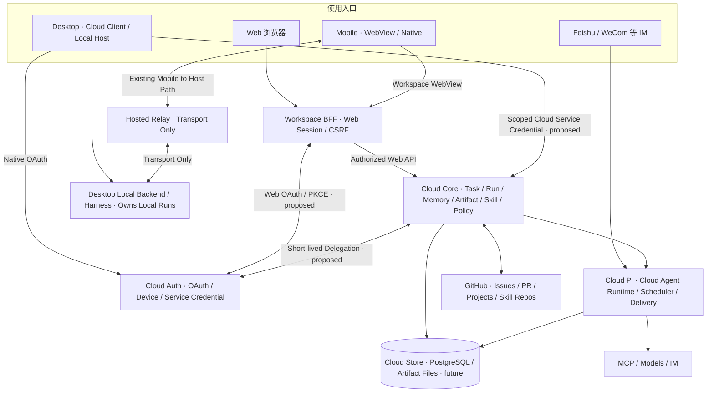

# Mira Cloud · 全栈产品与系统架构草案 v0.4

**状态：产品设计提案 / 实现合同未施工**  
**日期：2026-11-11**  
**目标：** 从 Cloud Pi（烤派）原型演进为具有持续工作、记忆、Skills/MCP、GitHub 协作和安全跨端工作交接的 Mira Cloud；由 **Web、Mira Mobile、Mira Desktop** 通过同一个 Cloud Account 接入，保留各自运行时的执行权。

> **后续技术选型决议（2026-11-11）：** 本稿作为产品边界/数据权威设计基线保留；其 SQLite 及数据库候选、Fastify/Node 部署表述由 [ADR-003](../decisions/ADR-003-hono-drizzle-postgres-deployment.md) 和 [初始技术设计](initial-technical-design.md) 覆盖：未来新 Core 采用 **Hono + Drizzle + PostgreSQL**，目标生产使用 **Docker Compose + Caddy**。当前没有新服务或部署。
>
> 本文是 **v0.3 的完整继承与修订版**，只定义产品边界、候选架构与演进路径，不代表这些能力已经实现，已建立独立设计仓库；不授权创建 GitHub Issue、修改运行时代码、上线或迁移生产。
>
> **总原则：One Account, Multiple Runtimes, Shared Work。** 同一个身份体系不等于相同的数据副本、共享超级权限或一个跨所有设备运行的 Agent 进程。

## 0. 产品定义、冻结方向与 v0.4 变更

### 已确认产品方向

- **Cloud Auth** 是独立身份和授权中心；现有 Cloud Pi 管理页面可继续留在 Cloud Auth Portal。
- **Mira Cloud** 是独立用户产品；未来 Web 工作台作为 Cloud Auth 的正式 OAuth 客户端，不依赖 Portal 页面 Session。
- **Cloud Pi** 是云端 Agent Runtime 原型：优先保留真实 Pi SDK、Scheduler、Research、Run、Delivery 与 MCP 执行基础，并逐步形成 Cloud Core；不另造平行执行内核。
- **Web + Mira Mobile WebView** 使用同一套响应式 Workspace Web 页面，视觉 token 以 pinned Mira Desktop 的 MiraDesign Foundation 为基准；Mobile 原生应用仍有自己的 Local Provider 和 Remote Host 入口。
- **Mira Desktop** 作为正式的 **Cloud Client** 接入 Cloud Core；同时继续是独立 **Local Agent Runtime / Capability Host**，本地优先，不强制登录云端。
- **GitHub** 仍是工程 Issue、Project、PR 和版本化 Skill 源码的事实权威，Mira Cloud 只记录自己的 Task/Run 与引用关系。
- **设计仓库已建立；当前不派卡、不施工、不部署。**

### 相比 v0.3 的关键改动

1. 访问面从 **Web / Mobile / IM** 扩展到 **Web / Mobile / Desktop / IM**；区分 Web BFF 会话与 Desktop 原生 OAuth/服务凭证。
2. 增加 **Desktop Cloud Client ↔ Cloud Core** 的受限读写合同；不可借用 Cloud Session、Relay 票据或 Portal Cookie 充当业务权限。
3. 增加 **Work Handoff / Task Link / Artifact Ref**：跨端交接的是经过授权的工作包与成果，而不是强制迁移模型会话、整库记忆或执行权。
4. 正式规定 **Cloud-owned 与 Desktop-owned Run 的写入权威不同**；另一个端只查看来源可靠的状态或发起受控请求。
5. 增加 **本地记忆/技能/文件默认私有，按需发布到云端** 和离线/断连恢复语义。
6. 保留 Mira Phase III **Mobile → Desktop** 的已批准方向；未来 Cloud Agent → Desktop Host 反向执行单列未来提案，当前不据此增加任何授权。

### 两个不同的概念

- **共享身份**：Cloud Auth 确认用户/设备属于同一账号，签发有 audience / scope 的服务资格。
- **共享工作**：通过业务侧对象权限、明确的交接行为与可追踪的 Artifact 引用，让多个 Runtime 合作完成一件事；不意味着默认同步所有数据。

## 1. 系统拓扑：统一入口，独立的执行事实



### 三个运行时，两个重要约束

- **Cloud Pi** 拥有 Cloud-owned Run 的执行/结果真相；**Desktop Harness** 拥有 Desktop-owned Run 的执行/审批/本地 Artifact 真相。**Mobile Local Agent** 拥有其自身已定义的前台本地调用上下文，不被强行改造成云端后台任务。
- Cloud Core **不得**因为同账户登录就远程启动 Desktop Tool。图中的 Relay 路线仅表示现有 Mobile→Desktop 授权传输；未来 Cloud→Desktop 主动委托必须有新的产品决定、安全模型和实现合同。

### 逻辑分层不等于部署微服务

建议 Core 以 Cloud Pi 的同机业务模块逐渐演进，部署仍优先轻量、单主写入；Web BFF 仅为必要的会话边界。Cloud Auth 独立维护。阿里云与腾讯云的互通、可达性、成本、部署归属需要实测，图示不代表已接通。

## 2. 模块职责与单一写入权威

| 领域 | 权威系统 | 业务约束 |
| --- | --- | --- |
| 账号、设备、OAuth、服务凭证 | **Cloud Auth** | 认证、撤销、Audience/Scope；不保存用户工作或模型秘钥 |
| Cloud Task / Trigger / Schedule / Run | **Mira Cloud Core / Cloud Pi** | 云端委托、调度、运行与账单的写入权威 |
| Desktop 本地 Session / Run / Tool / Approval | **Desktop Backend / Harness** | 本机数据、授权、取消、真实执行结果；不因云登录搬迁 |
| Mobile Local Provider 与会话 | **Mira Mobile** | 保持手机端本地模型与凭据所有权 |
| Cloud Artifact / Memory | **Mira Cloud Core** | 云端产物与记忆元数据、访问权、来源、留存 |
| Desktop 本地文件、知识、记忆、Skill 安装状态 | **Desktop Local Runtime** | 默认不云同步；只通过显式导出/引用共享 |
| 跨端 Work Handoff / Task Link | **发起交接的一方建立请求；目标执行者确认接收并维护其 Run** | 连接两个不同所有权的工作对象，不替代源 Run 状态 |
| Skills 版本、源码 | **Git 代码仓库** | 可复现 Commit；Cloud 和 Desktop 各自管理安装/启用 |
| MCP 调用权限 | **运行时 + 目标服务端** | 外部来源和工具 Schema 不等于可调用授权 |
| GitHub Issues / Project / PR | **GitHub** | Mira 只保存关联、执行记录与证据链接，不另造项目真相 |
| IM 投递幂等 | **Cloud Pi Delivery** | 可信收件人、结果审计与失败恢复 |
| Hosted Relay | **仅传输** | 票据不是 Host 的工具执行权 |

不可违背：**`GitHub Issue ≠ Cloud Task ≠ Desktop Run`**。一个工程 Issue 可关联多个 Cloud Task 和 Desktop Run，但它们的状态与权限始终由自己的权威系统写入。

**读取/展示分离于写入权威。** Desktop 可看到云端 Run 的状态，而不需要把它复制到本地 SQLite 当作另一份权威；云端可保存用户主动上传的本地 Artifact 快照，但不能据此推断 Desktop 原任务已经完成。

## 3. 业务对象：最小闭环

统一五个核心对象，但与现有 schedule/run 文件的兼容需要专门迁移设计：

1. **Task**：一项用户目标或工作委托。字段候选：`taskId`, `ownerAccountId`, `origin`, `title`, `instructions`, `requestedCapabilities`, `policyRef`, `parentTaskId?`, `githubIssueRef?`, `createdAt`。这是需要被完成的工作，不是某一次执行。
2. **Trigger**：执行时机。`manual`、`scheduled`（once/recurring）、`event`（后期）。手动临时任务也有 Trigger；Cron 只是触发的一种形式。保留 `scheduleId` 作为现有计划合同的标识。
3. **Run**：一个 Task/Trigger 的实际尝试。`runId`, `taskId`, `triggerId?`, `actor`, `status`, `attempt`, `startedAt`, `finishedAt`, `errorClass`, `modelUsage`, `costEstimate`, `capabilitySnapshot`。既有研究 Run 需要映射，不直接替换。
4. **Artifact**：工作产物。`artifactId`, `runId`, `ownerAccountId`, `type`, `storageKey`, `checksum`, `contentType`, `version`, `visibility`, `sourceRefs`, `createdAt`。文件不塞在表里；任务重试不覆盖旧产物。
5. **Memory**：带证据的可复用信息。`memoryId`, `scope`, `owner`, `sourceRun/Artifact/Conversation`, `content`, `confidence`, `reviewState`, `expiresAt?`, `createdAt`, `updatedAt`。记忆有删改审计和访问控制。

配套对象：`SkillInstallation`, `ConnectorGrant`, `RunEvent`, `Approval`, `DeliveryAttempt`, `CostLedger`。这些首先是领域概念，**不表示必须每个新建一张表**。

### v0.4 新增跨端关联对象（候选合同）

- **`RuntimeRef`**：`runtimeKind = cloud | desktop | mobile-local`，`runtimeInstanceId`（不可由用户文本自报）、`ownerAccountId?`。明确谁实际执行。
- **`WorkLink`**：`linkId`, `sourceTaskRef`, `targetTaskRef?`, `relation = continue | derive | import | reference`, `initiator`, `createdAt`, `approvalRef?`。只建立关系，不挪走源任务。
- **`HandoffPackage`**：`handoffId`, `sourceRuntimeRef`, `sourceRunRef`, `targetRuntimeKind`, `artifactRefs`, `contextSummary`, `requestedCapabilities`, `owner`, `scope`, `expiry`, `status`。交接请求可拒绝、过期、撤销。
- **`ArtifactRef`**：包含 `ownerRuntime`, `artifactId`, `contentHash`, `version`, `accessMode = read | snapshot | imported`，并指向明确来源。跨端复制时生成新 Artifact ID，保留原始来源链。

**合同优先于建表：** 哪些对象最终需要独立持久化，取决于实际恢复、审计与跨端需求。不得把 `Desktop Run` 的 `status` 复制为一份由 Core 可写的独立状态。

### Run 状态机（候选，需与现有 Run 兼容）

```text
queued → running → succeeded
         │   ├── partial
         │   ├── awaiting_approval → running / cancelled / expired
         │   ├── failed
         │   ├── cancelled
         │   ├── timed_out
         │   └── interrupted → pending_reconcile → queued / failed
         └── cancelled
```

- `Schedule.paused` 与 `Run.cancelled` 是不同事情；暂停未来触发，不等于终止运行中任务。
- 任务恢复原则是**至少一次触发 + 幂等键 + 可审计的重复判定**，不承诺跨模型/外部系统的绝对 exactly-once。
- 外部写操作如果返回未知结果，不自动盲目重试；先做只读对账或人工确认。
- 修改任务、完成任务、发送通知不能以“请求已接受”冒充“执行已完成”。

## 4. 四条典型工作链路

### 4.1 临时委托

1. Web/IM 输入目标；服务端绑定可信 account 或外部受限 actor。
2. Core 验证工具、预算、资源授权和幂等键，建立 Task + Trigger + Run。
3. Cloud Pi 执行 Run；进度按事件追加，不依赖常驻 HTTP 请求。
4. 生成 Artifact 和结构化结果；Delivery 发送可信配置目标；失败可分别查看。
5. 用户可从 Artifact 发起后续 Task，保留来源链。

### 4.2 定时计划

1. 管理员创建 Task + 计划（时区、下一次触发、预算、批准范围、投递目标）。
2. 保留现有 Scheduler 的可靠触发、错过触发、重启恢复和投递幂等合同。
3. 每次触发创建独立 Run；不会因一个周期失败而改写历史 Run。
4. 后台委托凭据按任务需要短时取得，不长期保存设备 Cloud Session。

### 4.3 GitHub 工程协作

1. 用户授权 GitHub App 的特定仓库；Core 读取 GitHub Issue 契约与组织现行政策。
2. 用 Cloud Task 关联 `repository`, `issueNodeId`；可先分析、生成计划，而不是默认施工。
3. 真正写仓库/创建 PR/合并/关闭 Issue 的能力各自具备独立授权和人机职责边界。
4. GitHub 提供 PR/CI/Project 当前状态；Mira 存 Run/模型成本/观察证据链接，不篡改 GitHub 真相。
5. `Done` 只是 Project 管理位置，CI 绿不等于产品验收，Agent 不能自行升级权限。

### 4.4 跨端工作交接（v0.4 重点）

#### A. Cloud → Desktop：在本地继续

1. 用户在 Web/Mobile/IM 委托云端研究；Cloud Pi 生成 `Cloud Task / Run / Artifact`。
2. Desktop 通过其已登录的 **Cloud Client** 读取账号有权访问的云端任务及成果；不使用 Portal Cookie 或 Relay Ticket。
3. 用户选定「在 Desktop 继续」，Desktop 获取可验证的 Artifact 引用/内容快照和任务背景，经本地权限检查创建 **新的 Desktop-owned Task/Session**。
4. 本地工具、文件、Browser 和审批仍由 Desktop Backend/Harness 执行；Cloud Core 只保留 `WorkLink`/交接证明，不伪造本地运行进度。
5. Desktop 可根据用户明确选择把新成果上传云端、关联原始研究；拒绝上传时本地成果仍留在本机。

#### B. Desktop → Cloud：让云端继续

1. 用户在 Desktop 选择一段明确的任务说明和可共享材料，预览敏感信息与上传范围。
2. Desktop 在用户授权后创建云端 Task / Artifact 快照；云端为该 Task 生成独立 `Cloud Run`，受自身模型预算和工具权限限制。
3. 这不是将本地活跃 Session 或模型 API Key 移交云端，也不提供原机文件路径读取能力。
4. 断网不等于取消。恢复后根据服务端 Task ID 和 Idempotency-Key 对账，避免重复创建或重复外部副作用。

#### C. Cloud → Desktop 主动执行（**未批准的远期提案**）

可以讨论按目标、时效、设备身份、具体 Tool Scope 的委托合同与 Desktop 最终审批，但 **当前不建立这条调用路径**。它超出现有 Phase III 的 Mobile→Desktop Host 合同，不可复用 Relay 传输票据冒充业务授权。未来实施前需明确批准、审计与撤销语义。

#### D. 断连与离线

- Desktop 离线：Cloud Task 仍按云端调度运行；本地 Task 保持原状态，不声称已同步。
- Cloud 不可达：Desktop 的本地会话/本地模型/本地工具继续可用；云端操作显示连接失败或等待对账。
- 重连：通过 `cursor / version / idempotency key` 读取源系统最新事实；不得靠客户端推测成功，也不得自动重放未知副作用。
- 跨端读取和下载都需要对象级 ACL 检查，旧链接可能失效；已经显式导出的快照可以按用户选择的保留规则存在。

## 5. 身份与安全架构：三种客户端，三种权限

### 5.1 Web 工作台：独立 OAuth 客户端

未来 Web 使用 **OAuth Authorization Code + PKCE S256**，优先 Web BFF 模式：BFF 处理 Code/Token 与会话，浏览器持 `Secure` / `HttpOnly` Cookie，执行 CSRF 防护、来源与跳转 URI 校验。必要时再引入标准 OIDC 身份声明。

**当前事实：** Cloud Auth OPS-016/017 的注册表只有 `mira-desktop` / `mira-mobile` 两个原生客户端，Token Exchange 返回设备绑定的 Cloud Session，并不提供可直接拿来给独立 Web 使用的通用 OAuth Web 客户端合同。新增 Web Client 属于未来明确扩展需求。

### 5.2 Desktop：原生 OAuth + Cloud Service Client

- 复用 Desktop 既有的 **Cloud Account 原生授权/设备身份路径**，不建第二个账户体系。不以存在 OAuth 合同推断当前已完成 Cloud Core API 端到端接线。
- 原生客户端持有的 Cloud Session 只用于 Cloud Auth 的本来职责（恢复、续期、获取专用 Service Credential）。凭证放在受控本地安全存储；不注入普通 Renderer 或传给 Cloud Pi。
- **Cloud Core 业务 API** 使用未来独立 `aud = mira:cloud-workspace`（暂定命名）与 `workspace.read`、`tasks.read` 等**候选** Scope 的短时专用凭证；当前 Cloud Auth 并未签发这些 Scope。服务端必须校验 `aud`、有效期、签发者、账号、设备与业务资源 ACL。
- 不得把 `relay.room` 票据、Cloud Auth Portal 的 Session、现有 Who You/Shiyan/Guanlan 凭证移作 Workspace 通用业务权限。
- Desktop 离线或退出 Cloud 登录后，本地 Agent 保持可用；撤权仅影响远程 Cloud 资源访问与已经明确存在的云授权 Host 能力。

### 5.3 Mira Mobile：本地能力与 WebView 并存

Mobile 有自己的设备会话和 Local Provider；WebView 使用与 Web 相同的 Workspace 页面，但需要 **独立、短时、可撤销的 Web 会话建立路径**。不向 WebView URL、JSBridge、任意网页脚本直接传递原生 Cloud Session、模型 Key 或长效 Bearer；可通过受控浏览器 OAuth 或一次性换票设计实现流畅体验，必须校验来源、重放、过期和跳转域名。

### 5.4 Cloud Pi 当前管理页面

现阶段继续位于 Cloud Auth Portal，由其既有维护者管理与受控代理保护。未来 Workspace 的用户级 `Task` 权限和该维护者管理权限是不同契约；不可用 `管理员当前能管理烤派` 推出 `所有云用户都可以管理烤派实例`。

### 5.5 身份与工具权限不传染

1. **Human/Auth**：人类账号及其设备/浏览器 Session 证明“谁在请求”。
2. **Cloud Resource ACL**：Task、Run、Artifact、Memory、安装的 Skill 谁可读取/修改；每条 API 由 Cloud Core 校验。
3. **Run Delegation / Tool Policy**：每次执行可用的最小 MCP、预算、时间、并发与副作用，后台委托可撤销，不靠浏览器 Session 常驻。
4. **Target Authority**：GitHub App installation、外部 MCP、邮箱/投递平台最终验证其自己的权限。
5. **Desktop Host Policy / Approval**：本地 Tool 调用始终由 Host/Harness 判断，Cloud 登录或同账号设备发现都不自动授予本机读写权。

跨服务器使用有目标 audience 的短时凭证，管理端口不向公网直接裸露。外部 IM 文本、仓库 README、技能脚本、网页内容一律不可信；模型不能自报 `accountId`、`deviceId` 或提升 Scope。

**撤权语义设计要求：** 撤销账号/设备/Scope 后，不能再获得新服务凭证；已签短期凭证需要明确的 TTL 与敏感操作再验证策略。跨端授权、Host grant、具体工具审批各自独立，不得视为一次登录完成的附赠权限。

## 6. 记忆系统

阶段 1：结构化用户偏好 + 手工认可的记忆条目、任务关联检索；目标采用 PostgreSQL 全文检索优先，不因“记忆”两字直接搭建向量数据库。

阶段 2：记忆候选由 Agent 提取，区分 `candidate` / `approved` / `rejected`，绑定准确来源。未经用户授权或来源不足的材料不直接晋升为私有长期记忆；公开群聊不会继承私人记忆。

阶段 3：在真实检索问题证明 FTS 不够时再按需加入嵌入检索。记忆修改、删除、导出和保留期限是产品基础能力。

### 6.1 v0.4 的跨端记忆边界

- **Desktop 私有记忆是本地的事实**：未授权时 Cloud Core 不可读、不可搜索、不可自动同步。
- **Cloud Memory 是独立云端资源**：用户可以在 Desktop 中按权限查询或引用；“可查询”不代表“自动写入本地记忆库”。
- **共享动作是显式的**：发布到 Cloud、从 Cloud 导入、引用云端某一条记忆是不同操作，记录来源、目标、修订、用户身份和撤销/删除影响。
- 不使用 `last-write-wins` 自动覆盖相互矛盾的隐私/工作偏好。对于内容冲突，保留来源和时间并请求用户审阅。
- 群聊/公开 IM 提炼的候选记忆不能未经授权进入私人 Cloud Memory，更不能自动散发到 Desktop 或 Mobile。

## 7. Skills / MCP / GitHub

### Skills

- 以 Git URL + Commit SHA / Release digest 锁定可复现版本；保存 manifest、最小权限声明和所需运行依赖。
- 安装、更新、执行是三种独立操作；不允许未知 Skill 的安装隐式授予终端、网络或文件写入权限。
- Mira 可从已验证 Run 提出 Skill 改进草案，但提交仓库或启用新版本需具备相应权限/审批。

### MCP

- 沿用 Cloud Pi 的 Pi 原生 MCP Extension，先支持当前可信第一方服务；stdio 与远端 Streamable HTTP 都要求显式源/工具白名单。
- 工具描述和只读注解不是最终授权。运行时在每一次实际调用前检查 tool policy 和服务侧授权。
- 不立即建设通用 MCP Marketplace、Gateway 或平台级工具发现数据库。

### GitHub

- 优先 GitHub App：按 Installation 与仓库范围授权，令牌短期化，权限可收窄、撤销。
- Issues/PRs/Projects 实时读取或缓存投影；以 GitHub 为源，不复制管理状态。
- GitHub 发布适合版本化 Skills、代码与经过选择的研究成果；不适合实时 Run 状态或敏感长期记忆。

### 7.1 跨端技能与 GitHub 的能力作用域

- **Skill 源码版本可共享，安装状态和执行权限不共享。** Desktop 安装 `Skill@commitA` 与 Cloud Pi 安装同一版本是两次独立的能力启用；所需终端/文件/MCP 许可分别审查。
- Desktop 通过 Cloud Client 可以浏览云端 Skill 清单与仓库来源，但不得让云端直接改写本地 Skill 目录；本地安装需要用户授权及本机校验。
- GitHub Issue 的任务合同由 GitHub 保留；云端研究 Run 与 Desktop 工程 Run 只链接同一 Issue，不能以一个运行体的成功推导另一个运行体或 Issue 的验收结论。

## 8. 存储与运行部署

**现状**：Cloud Pi `dev` 的 Scheduler、Research Run、Delivery 各使用原子文件写入，文件存储明确假设单个进程独占 stateDir；不存在通用多节点共享事务数据库。核心运行入口目前也是单进程装配。

**候选目标**（不是已批准数据库迁移）：

- **PostgreSQL + Drizzle** 是未来 Core 的当前推荐技术栈（详见 ADR-003），承担 Task/Run 索引、审批、记忆元数据、成本与关联关系；当前 Cloud Pi 文件 store 在迁移前仍独占其事实。
- **本地数据卷 / 对象存储** 承担 Markdown、JSON、文件 Artifact；数据库只存元数据、校验和、归属、版本和相对存储键。
- **GitHub** 承担代码、Issue/Project/PR 和版本化 Skills 的真相。
- **独立加密备份**：定期备份数据库、文件卷及版本化配置，恢复时核对 Run、Scheduler、Delivery 三者一致性；日志与产物有保留/容量配额。

**迁移方法**：不让旧文件 store 与新 SQL store 双写；先定义版本化读/转换合同与影子校验，维护窗口执行原子迁移与回退决定。旧格式可归档，只有一个调度器拥有生产触发写权。

**跨端数据所有权（v0.4）：** Desktop 现有 SQLite、工作目录、本机密钥和 Local Agent Session 保留在 Desktop 端，不因 Cloud 数据结构引入而迁移。云端只保存用户显式提交的快照、Artifact 元信息和可撤销的交接关系。移动端本地 Provider 凭证同样不上云；删除 Cloud Artifact 与清除 Desktop 原文件是两个互不隐式触发的操作。

**2C4G 腾讯云候选**：默认一个 Agent Worker 并发，按 CPU/内存/模型成本实测后逐步提高；PostgreSQL 单实例为新 Core 候选；不引入 Redis、Kubernetes、独立向量数据库或常驻浏览器。跨阿里云的 Cloud Auth、New API 通道要先进行实际连通性、安全性与鉴权验收。

## 9. API 合同草案（仅命名和语义，不是已存在端点）

| API | 语义 |
| --- | --- |
| `POST /api/tasks` | 创建受授权 Task，接受 Idempotency-Key，返回 Task ID / 状态 |
| `GET /api/tasks` / `GET /api/tasks/{id}` | 分页读取可访问任务及其关联运行 |
| `POST /api/tasks/{id}/runs` | 触发一次新 Run；可携带经校验的输入 Artifact 引用 |
| `POST /api/runs/{id}/cancel` | 请求取消；状态由执行引擎后续确认 |
| `GET /api/runs/{id}` / `GET /api/runs/{id}/events` | 获取最终状态和可重放的游标事件 |
| `GET /api/artifacts/{id}` | 按归属/权限读取元数据并安全下载 |
| `POST /api/schedules` / `PATCH /api/schedules/{id}` | 计划创建/变更，必要时采用修订号防并发覆盖 |
| `GET /api/memories` / `POST /api/memories/{id}/review` | 记忆查询、候选审阅、编辑与删除 |
| `GET /api/skills` / `POST /api/skills/installations` | 技能来源、锁定版本、安装/启停状态 |
| `GET /api/integrations/github` | 已授权仓库与连接状态；GitHub 事实来自 GitHub |
| `GET /api/cloud/work` | Desktop/Web/Mobile 统一查看授权范围内的 **Cloud-owned** 工作摘要；不含伪造本地状态 |
| `POST /api/handoffs` | 发起 Cloud→Desktop 或 Desktop→Cloud 交接请求，提交来源、目标、最小上下文与授权范围 |
| `GET /api/handoffs/{id}` | 查询交接状态、到期、拒绝与源/目标对象关联 |
| `POST /api/handoffs/{id}/accept` | 目标客户端按当前身份接收明确授权的交接；仅在目标拥有执行能力时创建目标工作 |
| `POST /api/artifacts/import` | 用户显式上传或导入可访问 Artifact 快照，服务端校验所有权、大小、类型和哈希 |
| `GET /api/work-links` | 读取与当前账号相关的跨端工作关联，仅是来源投影，不修改任一 Runtime 事实 |

首期实时更新：HTTP + SSE（带游标恢复），不因任务进度引入 WebSocket 依赖或事件总线。鉴权 BFF 负责 cookie/CSRF；核心业务服务对每个对象实施资源级授权。上述端点均为**候选接口**，不表示服务器已存在；命名可能与真实 Cloud Pi API 发生归并。`/api` 是示意业务网关前缀，绝不是 Desktop Local Backend 的路由约定。

Desktop 客户端需要专用 `CloudApiClient`/身份 Adapter，不通过将 Cloud Bearer 塞进 Renderer 的 fetch 来实现；Web BFF 以及 Desktop 本地 Backend 分别控制请求边界。

## 10. 产品 UI：三端使用同一产品概念，不强求同一组件树

### Web & Mobile WebView

工作台：总览 / 临时委托 / 定时任务 / 运行记录 / 成果库 / 技能与 MCP / GitHub / 记忆。响应式 Web 页面同源；Mobile 原生侧仍拥有导航、安全区域、分享、通知等设备责任。

**Web 设计 token** 使用 pinned Mira Desktop `desktop/src/shared/theme/colorThemes.ts`、`desktop/src/styles.css` 与 `desktop/tailwind.config.cjs` 作为权威（AGT-047 固定 commit `5036067d3a87ba95d798e01ededc7fbd678327de`）：语义 surface/text/icon/status、primary scale、间距 4/8/12/16/20/24/32/40、圆角 8/10/12/14/16/18/20；保留四套主题及 light/dark。不要将 Cloud Auth 的黑白蓝控制台 CSS 不经审查直接作为 Workspace UI。

### Desktop 集成体验

Desktop **不是必需用 WebView 嵌入整份云工作台**，也不为了云功能替换现有 Electron/React UI 栈；优先在现有页面/导航加入云端入口，并以 typed Cloud API Adapter 展示：

- 「云端工作」：显示已授权云端 Task、Run、调度、Artifact，明确云端/本地区别；
- 「在本地继续」：将云端 Artifact/工作上下文形成新的 Desktop-owned 工作，并展示交接关系；
- 「交给云端继续」：选择性提供材料与权限，创建 Cloud-owned Task，不上传整份本地 Session；
- 「我的能力」：云端 Skills/MCP 来源与 Desktop 本地安装状态并排展示，但权限与可用性分别判断。

视觉上遵守 Desktop 已有组件和交互规范，在适宜的独立 Web 视图里消费 Desktop-derived MiraDesign token；不因“统一设计”强行替换 Desktop 本地全套 UI，也不要求三端运行同一套 React 组件。

### 通用状态与文案规则

所有终端必须明确标注执行位置：**Cloud / 本机 Desktop / Mobile Local / 远端 Host**；显示「等待授权」「离线」「同步待确认」「已交接」等真实状态。禁止把操作请求成功提示成最终执行成功，把下载完成提示成任务已被本地 Agent 接收，或把同账号发现提示成工具有权限。

## 11. 演进阶段与验收决策

| 阶段 | 核心结果（仍为设计目标） | 关键条件/反例 |
| --- | --- | --- |
| P0 · 合同设计 | Cloud Task/Trigger/Run/Artifact + RuntimeRef + WorkLink 的写入权威、恢复合同 | 不预先建第二套数据库，不修改 Phase III 的 Host 权限 |
| P1 · 云端工作闭环 | Cloud Pi 临时委托、调度、运行、成果、审批/成本的真实可观测性 | 失败与发送结果分离，不靠界面模拟冒充后端实现 |
| P2 · 独立身份 | Web OAuth+BFF、Cloud Core 用户资源 ACL、后台最小委托 | Cloud Auth 当前仅支持原生 OAuth；须补 Web client 合同 |
| P3 · Desktop Cloud Client | 用已有 Desktop Cloud 登录访问云 Task/Run/Artifact；可靠恢复、注销与撤权 | 不再创建第二登录；不破坏本地/无云路径 |
| P4 · 显式跨端交接 | Cloud→Desktop、Desktop→Cloud 的只读/快照式 Handoff 与源引用 | 不隐式同步本地目录、私密记忆或 Provider Key |
| P5 · 成长能力 | 记忆、Skills、MCP、GitHub 的可控复用与来源审查 | 不建设无需求的商城、数据库集群或第二套 GitHub Project |
| P6 · 高阶自治（需新裁决） | 隔离执行空间与必要的双向 Runtime 协作 | Cloud→Desktop 主动工具执行不在现有 Phase III 授权内 |

**每一阶段均不等同于已获工程授权、施工卡或发布日期。**

### 仍需后续独立裁决的问题

1. Mira Cloud 最初是个人自托管、有限账号还是商业多租户：推荐按账号隔离设计，按单主机部署起步，不提前建多租户运营平台。
2. 是否允许 Cloud Agent 在长期授权下主动触发某个 Desktop Tool：建议先完成显式 Artifact 交接，再由未来单独产品合同决定。
3. 哪类本地记忆/Skill 可以同步：建议默认本地私有，选择性发布，不做静默双向同步。
4. Desktop 云入口最终是原生 UI 优先，还是在少量管理页面嵌入独立 Workspace Web：建议优先原生 UI 与 Cloud API Adapter，具体按用户旅程决定。
5. 云端运行是否需要隔离 Shell/Browser：先证明真实需求、授权与资源可控，再选择可复现的沙盒方案。

## 12. 已核对的事实基础与约束（2026-11-11）

- Mira Organization `main` AGENTS（revision `2026-09-16.2`）：https://github.com/uichat-mira/.github/blob/main/AGENTS.md
- Organization 单一事实来源：https://github.com/uichat-mira/.github/blob/main/docs/governance/source-of-truth.md
- Mira Desktop `dev` 运行时边界：https://github.com/uichat-mira/mira-desktop/blob/dev/AGENTS.md 、 https://github.com/uichat-mira/mira-desktop/blob/dev/docs/architecture/README.md
- Mira Desktop Phase III 的现行维护者合同（尤其 **Mobile→Desktop** 与 Relay 权限边界）：https://github.com/uichat-mira/mira-desktop/issues/315
- Cloud Pi `dev` 的真实组合根： https://github.com/uichat-mira/cloud-pi/blob/dev/src/app.mjs
- Cloud Pi 当前 Scheduler、Research Run、Delivery 是单进程文件存储： https://github.com/uichat-mira/cloud-pi/blob/dev/src/scheduler/store.mjs 、 https://github.com/uichat-mira/cloud-pi/blob/dev/src/research/run-store.mjs 、 https://github.com/uichat-mira/cloud-pi/blob/dev/src/delivery/store.mjs
- Cloud Auth 现有 OAuth 仅面向两类 native client：https://github.com/uichat-mira/cloud-auth/blob/dev/docs/oauth-authorization-v0.md
- Mira Mobile 的 Local Provider / Remote Host 边界：https://github.com/uichat-mira/mira-mobile/blob/dev/AGENTS.md
- MiraDesign token 真相源：https://github.com/uichat-mira/mira-desktop/blob/dev/desktop/src/shared/theme/colorThemes.ts
- OAuth Security BCP：https://www.rfc-editor.org/rfc/rfc9700.html
- OAuth Browser-based Apps BCP：https://www.rfc-editor.org/rfc/rfc10017.html

### 与 v0.3 的关系

此稿**完整继承并替代 v0.3 的整体架构设计**；保留 v0.3 文件作为讨论历史，不反向修改已在各仓库生效的工程合同。文中「未来」「候选」「规划」不代表当前功能、可达性或生产环境已经验证。

---

**v0.4 技术主张：** Cloud Auth 统一身份；Cloud Pi 演进为持续工作的云端 Runtime；Cloud Core 负责云端任务、记忆、技能、成果和受限交接；Desktop/Mobile 保留本地运行时和各自执行权；同账号让工作可被发现、引用与明确交接，**而不是默认共享本地数据或执行权限**。