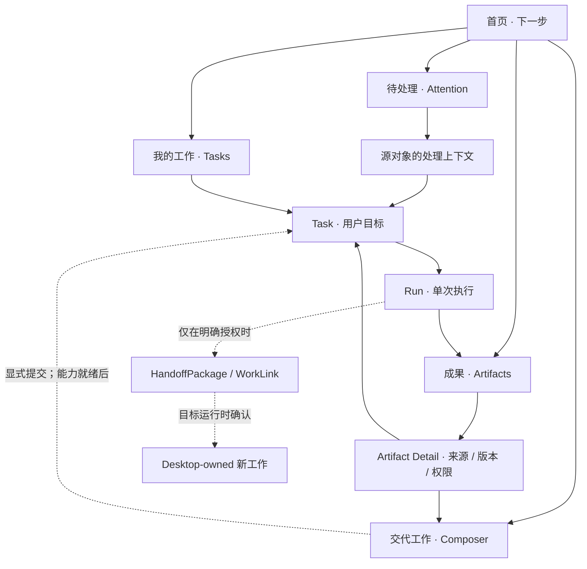

# Mira Cloud Workspace — 个人持续工作空间产品合同

**Status:** AGT-051 · 产品信息架构 / Home 体验设计合同（仅设计，尚未实现）  
**Decision:** 方向 A — Personal Continuous Workspace（2026-11-12）  
**Work item:** [AGT-051](https://github.com/uichat-mira/mira-cloud/issues/70)  
**Authority:** 本文件是 Workspace 用户体验合同的单一入口；[架构 v0.4](../architecture/v0.4.md) 约束数据/运行时所有权，[DESIGN.md](../../DESIGN.md) 与 [MiraDesign](../design/component-library.md) 约束视觉和组件消费。任何矛盾应明确提出，不能以本文重写真实运行时或安全权限。

> **实现事实与设计提案分开看：** 当前 `apps/web/src/pages/workspace.tsx` 仅有「工作台／任务／成果」导航、基础设施连接检查及无数据占位；没有真实 Cloud Auth Web 业务登录、Cloud Task / Run / Artifact 服务和跨端交接。下文路由、操作、状态与演示情境均为**未来产品合同**，并非已部署能力。旧版 `prototypes/workbench-v0.1/` 是另一种 Run / Scheduler 优先的概念模拟，不能作为本版 IA 的权威。

## 1. 产品承诺及首要取舍

Mira Cloud 是一个用户能长期交代、接续与复用工作的**个人工作空间**，不是 Agent 运维台、CI 管理台或团队项目首页。用户进入后应当在短时间内回答五个问题：

1. 我交代过什么？
2. 哪件事情正需要我处理？
3. 工作做到哪里、由谁在哪个运行时执行？
4. 留下哪些可复用成果？
5. 怎样继续，而不是重复从头来？

**首页取舍顺序：Attention > Continuity > Creation > Statistics。** 这是视觉/交互决策的优先级，不是禁止用户随时新建工作；「交代工作」是永远可达的主操作，Recent Artifacts 是产品核心区，Statistics 首版不占首屏。普通人首先看到自己的工作，而不是 Run ID、Token 数、队列、Cron、模型或 Worker。

以下是产品红线：

- Task 是目标，Run 是一次执行尝试；**浏览工作不等于触发执行**。
- Artifact 的发现/访问/复用独立于 Run 历史，不要求用户回想执行编号。
- Attention 只代表需要用户处理的事项；普通进度、成功日志、定时器触发不制造待处理红点。
- 任何 UI 只投影来源系统能够证明的事实；`requested != running`、`cancel_requested != cancelled`、`delivery success != run success`。
- Cloud／Desktop／Mobile 各自保有独立运行时和对象权限；账号一致、可见引用、Relay 传输均**不等于** Host Tool 调用授权。
- 讲清楚用户可做的事，不在首屏堆系统架构说明。无能力时如实禁用或明确标记 fixture。

## 2. 信息架构与路由合同

### 2.1 系统级 Shell 与当前「工作」业务

Mira Cloud 不再把「首页 / 待处理 / 我的工作 / 成果」冻结为系统永久一级导航。它们只代表当前 **工作（Work）** 业务面向的一期视图与对象入口。**当前系统级 Layout 只有三层**，不提供统一的 Topic Tab 栏：

1. **L0 · Global Rail** — 上方切换业务工作台（当前仅「工作」开放；知识、自动化、连接仍禁用），下方固定「消息中心」「设置」两个全局入口。它们不是「工作」的子模块，切换时对应的 L1 导航和当前选中态一起变化。
2. **L1 · Workspace Sidebar** — 只提供当前模块内部的导航：「工作」含工作台（首页 /）、全部工作/待处理/成果、Task 与交代工作；「消息中心」含全部消息/送达记录；「设置」含通用/通知与送达/连接诊断。Mobile 使用对应的左侧 Drawer 投影。
3. **L2 · Content Canvas** — 当前主题的主内容。打开 Task、Artifact 或其它对象时保持 Rail、Sidebar 和上下文标题稳定，切换内容由该内容附近的明确链接承担，不另设全局 Topic Tabs / 占位导航条。

当前「工作」业务的已知入口仍保留以下路由，但它们不再等价于系统级产品导航：

| 工作业务入口 | 候选路径 | 用户期待 | 列表/内容事实 | 不承担 |
| --- | --- | --- | --- | --- |
| **概览** | `/` | 现在要注意什么、从哪继续 | 用户获权可见的 Attention、Task 进展、最近 Artifact | 运行/系统监控全量表 |
| **待处理** | `/attention` | 需要我决定、补充、核对什么 | 由源对象投影的待处理事项，按可行动性排序 | 普通通知、第二份审批状态库 |
| **全部工作** | `/tasks` | 我的目标、进度、历史接续 | 受权 Task 列表；Run 藏在 Task 之下 | 独立 Run 首页、GitHub Issues 的复制 |
| **成果** | `/artifacts` | 找到、使用、追溯产物 | 受权 Artifact 索引及版本/来源 | 无权限文件的目录索引 |
| **交代工作** | 当前 route + Composer Modal（legacy `/new` 兼容） | 提交目标与边界 | 当前上下文内的 Delegation Composer；结构化目标/材料/能力/权限预览 | 独立页面切换、直接执行的聊天输入框 |

- 「交代工作」是当前「工作」业务的高可达主操作，但不意味着未来所有业务工作台都必须复用同一种创建动作。
- 「全部工作」「待处理」「成果」均由当前 Work 的 L1 Sidebar 担任可达入口；「工作台」由 Work Sidebar 与 Mobile 对象 Drawer 的首页入口承担，指向根路径 `/`，只在根路径激活。点击 L0「工作」也进入同一个驾驶舱，不增加全局 Tab。
- 任务详情：`/tasks/:taskId`；任务下的一次执行：`/tasks/:taskId/runs/:runId`；成果详情：`/artifacts/:artifactId`。打开详情时不得另起一套全局 Shell。
- Attention 列表是聚合入口，处理地点优先指向其**源 Task / Artifact / Handoff 的受控操作上下文**，而非复制一份可编辑 Decision。具体 URL 可在后续领域卡内落定；不得猜测 `/attention/:id` 已有后端资源。
- Schedule / Trigger、Runs、Memory、Skills / MCP、GitHub、连接及诊断、权限设置是否成为未来业务工作台、Sidebar 对象或内容级入口，由各自稳定产品身份决定；不得仅按当前功能数量塞入 Global Rail。
- Web 与 Mobile WebView 共享同一业务层级语义；Mobile 只改变折叠与触达方式，不创建第二套 IA。Desktop 原生 Cloud Client 是另一客户端，并非默认共享 Web Session。

### 2.2 IA 关系图（产品投影，而非数据库图）



箭头表示**查看、关联、授权后的动作**，并不代表这些 API 当前存在。Task 的多次 Run 不互相覆盖；一次 Run 可以产生多个 Artifact 或部分 Artifact；Artifact 的来源 Run、版本和访问权始终可审计。

### 2.3 导航、深链与返回规则

| 从哪里来 | 打开后 | 返回 / 异常 |
| --- | --- | --- |
| Home Attention → 源 Task Decision | 保留来源 Task 标题、等待原因、要求的具体决定；批准动作必须二次审视范围 | 完成后返回 Task，并更新 Home 投影；取消保持原状态 |
| Home Continuity → Task | 默认落在 Task 的「当前进展 / 下一步」，而非 Run 日志顶部 | 返回原 Home 滚动位置；深链直接打开无需先进入 Home |
| Task → Run | Run 必须隶属于当前 Task；展示真实执行位置与结果来源 | 返回所属 Task；ID 不匹配给出不可访问/不存在，不错误回退他人记录 |
| Home / 成果库 → Artifact | 直接读取获权版本、来源、可用操作 | 返回来源页面；源对象被撤权/删除时仅展示仍有权的元数据 |
| Artifact → Composer | 显式引用 ArtifactRef，展示类型、来源、版本、可见权限 | 取消返回 Artifact，不产生任务或上传 |
| Cloud → Desktop Handoff | 显式选择上下文 / Artifact / 目标设备；先创建待接受交接请求 | 目标未接受、离线、过期或拒绝都回到来源，不称「已在 Desktop 运行」 |

- 未认证：进入受控登录/恢复流程（**具体 OAuth 路径尚未实施**）；不把缺失会话当空账号。
- 403 / 不可见对象：解释「无权限查看」，不暴露敏感标题与来源；404 区分不存在；暂时断连保留最后可信快照并标注时间。
- 无法恢复原浏览位置时，返回上一级来源对象或相应列表；不把用户丢到空白页。
- URL 只传不具备授权效力的对象 ID、列表筛选或来源参数；不放凭证、原始材料、Host 票据或本地文件路径。

## 3. 首页信息层级与排版预算

### 3.1 首屏编排

| 区域 | 用户疑问 | 常态显示量建议 | 可见字段 | 操作 |
| --- | --- | --- | --- | --- |
| **Attention** | 什么正在等我？ | 最多 3 条，余量去待处理 | 对象标题、所需决定、阻塞原因、可信时间/到期提示 | 「查看并处理」→ 源操作上下文 |
| **Continuity** | 我的哪些工作值得接着关注？ | 2–4 张 Task | 用户目标、已验证进展/未知、执行位置、上次实质更新、下一步 | 「查看工作」→ Task |
| **Creation** | 我如何交代新的工作？ | 1 个持久可达主入口 | 「交代工作」 + 极短辅助文案 | → Composer，**不直接运行** |
| **Recent Artifacts** | 最近留下了什么？ | 2–3 项，余量去成果库 | 标题/类型/版本、来源 Task、可访问性、变更时间 | → Artifact Detail |
| Statistics | 我做了多少？ | 首轮不显示 | 无 | 无 |

「Creation」虽列在决策排序的第三位，**导航中的全局主操作始终可见**；不要求用户滚动至列表末尾才能开始。真实数据在无权/未知/离线时不能拿假 fixture 填补数量。

**排序规则：**

- Attention：优先当前明确阻塞用户工作的事项，其次可靠截止时间，再次最近有实质变化；无截止值不能伪造紧急度；同源同义事项去重，不以底层重试次数制造多条。
- Continuity：优先用户主动置顶/明确需要接续，再次存在待处理的 Task，最后最近可信进展；同一 Task 多 Run 只出现一次，切换最新 Run 不刷一整排重复卡。
- Artifacts：按用户最近操作/可信更新时间展示，并允许版本去重；不能跨 ACL 索引；每项可追溯 Task / Run / 版本。
- 只有真正需要用户决策的事情才能挂 Attention 标记；昂贵的重试、普通执行状态变化只在 Task 里说明。

### 3.2 Desktop 宽屏结构（信息线框，不是现成 UI）

```text
┌───────────────────┬─────────────────────────────────────────────────┐
│ Mira Cloud        │ 你的工作                                        │
│ 交代工作 +        │                                                 │
│                   │                                                 │
│ 首页              │ 需要你处理                         查看全部    │
│ 待处理            │ ┌────────────────────┬────────────────────┐ │
│ 我的工作          │ │ 决定 / 待补材料       │ 决定 / 待确认      │ │
│ 成果              │ └────────────────────┴────────────────────┘ │
│                   │ 接着做                             查看全部    │
│ 主题 / 账户        │ ┌────────────────────┬────────────────────┐ │
│ 连接诊断（次级）   │ │ Task 当前进展        │ Task 当前进展       │ │
│                   │ └────────────────────┴────────────────────┘ │
│                   │ 最近成果                            成果库     │
│                   │ [Artifact · 来源]  [Artifact · 来源]           │
└───────────────────┴─────────────────────────────────────────────────┘
```

允许桌面以两列卡片保持密度，但阅读顺序始终先 Attention、再 Task，再成果；不在首页放连接健康面板、Run 时间线或使用统计。已有 `ConnectionPanel` 的真实探测逻辑应保留，后续放到诊断/设置或仅在影响用户时提供简短连接提示，**不能删除真实故障反馈**。

### 3.3 Mobile / WebView 窄屏结构

```text
┌────────────────────────────┐
│ Mira Cloud                 │
│ 你的工作          [交代工作 +] │
│ 需要你处理       查看全部   │
│ [待决定事项 · 单列]          │
│ 接着做           查看全部   │
│ [Task · 当前进展 / 下一步]  │
│ [Task · 当前进展 / 下一步]  │
│ 最近成果         成果库     │
│ [Artifact · 来源]          │
│                            │
├────────────────────────────┤
│ 首页  待处理  我的工作  成果 │  ← safe-area bottom
└────────────────────────────┘
```

- 四个标签在移动窄屏须实际可容纳；若极窄或字体放大导致拥挤，使用经过走查的简洁标签/次级菜单，**不得横向溢出导航作为常态方案**。
- 任务/成果详情可收起底部导航，但必须提供可预测的原生返回/浏览器返回；不让 WebView、浏览器地址和页面返回互相争夺。
- Mobile 顶层 workspace/object header 只承载切换与当前上下文；「交代工作」下沉到当前 Work 内容/对象层。
- Coarse pointer 可操作面积至少 **44×44 CSS px**；Safe Area、`100svh`/`100dvh`、键盘遮挡、动态视口、No-hover、focus-visible 与弱网恢复遵循 [DESIGN.md](../../DESIGN.md)。
- Desktop 使用 MiraDesign 的紧凑密度，不复制移动端大控件；四种主题和明暗模式由 Cloud 自有 MiraDesign Foundation 提供，**没有另造 Token**。

### 3.4 页面状态（不能用「空」掩盖错误）

| 情境 | Home 行为 | 用户可做什么 |
| --- | --- | --- |
| 新账号，数据查询确认成功且确实空 | 不制造四块空面板；「交代第一件工作」置于主要位置，辅以成果的后续价值 | 进入 Composer |
| Attention 确认为空，有 Task | Attention 区域收起，Continuity 上移；不显示「一切都完成」 | 继续 Task 或新建 |
| 只有 Artifact、没有可继续的 Task | 最近成果成为主区域，Creation 保留 | 查看/引用 Artifact |
| 有待处理事项 | 把真实 Decision 前置，提示原因而非仅显示红点 | 打开原始操作上下文 |
| 有进行中的 Run | Task 显示真实执行来源、上次进展与可能的未知；不自动生成 Attention | 查看 Task / Run |
| Task 已完成，仍有后续价值 | 显示可读成果、后续工作入口；「继续工作」不自动重跑旧 Run | 查看成果 / 显式创建后续 Task |
| 初次加载 / 更新中 | 局部 Skeleton；保留既有导航和已确定旧内容，不伪装刷新已成功 | 等待或取消导航 |
| API 离线 / 状态暂不可达 | 显示「暂时无法更新」及最后成功时间（若有），不要展示 0 项/成功 | 安全重试/查看可访问缓存 |
| 权限被拒绝 / 会话失效 | 不暴露标题、计数或受保护内容；展示受控重新认证入口 | 登录恢复/返回 |
| 部分来源过期或状态未知 | 可用区域保留，失真数据隔离，Unknown 不自动推断 failure / success | 查看来源、刷新、联系负责运行时 |
| 长时间无进展 | 表述「最近更新于… / 暂无进一步进展」，不自造超时、停机或 Attention | 查看实际 Run 状态 |

## 4. 对象、权威与状态语义

### 4.1 关系和写入边界

| 对象 | 产品角色 | 权威来源（设计目标 / 当前实现） | 首页能显示什么 |
| --- | --- | --- | --- |
| **Task** | 用户目标、长期持续工作的容器 | 未来 Cloud Core Task 合同；当前仅有本地 metadata 基础，**不是** Cloud Pi 通用 Task | 受权标题、可信聚合进展、后续入口 |
| **Trigger / Schedule** | 执行时机与计划，不是目标本身 | Cloud Pi 既有 Scheduler；未来授权映射 | Task 内的下次触发 / 计划状态；不单独占首页 |
| **Run** | 一次真实尝试，可多个 Run 属于同一 Task | Cloud-owned 来源 Cloud Pi；Desktop-owned 来源 Desktop Harness；不可互写 | 作为 Task 的进展依据，不抢独立主栏目 |
| **Artifact / ArtifactRef** | 独立可读、追溯、复用的成果 | Cloud Core 保存云端 Artifact；Desktop 文件默认仅本地，显式上传/引用后才可读 | 标题/版本/类型/来源和获权入口 |
| **Attention / Approval / Decision** | 要用户行动的投影 | 源运行时/授权系统/业务对象；Home 仅聚合，不擅自写入状态 | 可行动摘要、阻塞理由、源对象 |
| **DeliveryAttempt** | 投递结果，与 Run 成果正交 | Cloud Pi Delivery | Task / Artifact 内单独说明发送结果 |
| **WorkLink / HandoffPackage** | 两个所有权不同的工作之间的显式交接 | 发起方负责请求，接收方确认是否建立其自身工作 | 仅可见「待接收 / 已确认 / 被拒绝」等有证据状态 |

**不可等价：** GitHub Issue ≠ Cloud Task ≠ Desktop Run；`WorkLink` ≠ 数据/权限迁移；看到 Cloud Artifact ≠ 能使用 Desktop 本地工具。外部 API、审批、计划、Host 授权的写入均由原系统负责。展示时应保留 `source/runtime`、`observedAt`、`permission`、`unknownReason`（这些是**投影字段示意**，不等于新 DTO/API）。

### 4.2 状态映射：不要为了统一标签改写事实

此表是**候选展示投影**；页面不可把它当作后端枚举或在前端补写不存在的数据库状态。

| 已证实的来源事实 | 用户展示建议 | 禁止推断 / 显示 |
| --- | --- | --- |
| 请求被接收；还未创建或观察到 Run | **已交代 · 等待开始** | 「正在运行」 |
| Run 确实 `queued` | **排队中** | 「执行中」 |
| Run 确实 `running` 且状态可信 | **正在进行** + 真实执行位置 | Agent 正在某个具体步骤（若无证据） |
| 源 Run `awaiting_approval`，审批有效且用户有处理权 | **需要你的决定** | 普通通知、自动批准 |
| 取消请求已受理但未确认结束 | **正在请求取消** | 「已取消」 |
| 源 Run 确实 `cancelled` | **已取消** | 「失败」或「完成」 |
| 源 Run `failed` / `timed_out` / `interrupted` | **失败 / 超时 / 中断**，并解释恢复选项 | 「没有任何成果」或自动重试未知外部副作用 |
| 源 Run `partial` 或失败 Run 关联可用 Artifact | **部分完成 · 有成果可查看** | 把整个 Task 宣告成功 |
| 来源明确 Run 终态为 `succeeded` 或 `completed` | **本次执行完成**；保留来源原值 | Task 自动完成、成果可取、投递已成功 |
| Artifact 可访问且有版本 / 来源证据 | **成果可查看** | 证明所属 Run 已成功或外发已成功 |
| Delivery 结果成功 / 失败 / 未知 | **已投递 / 投递失败 / 投递待核对**（独立子状态） | 把投递状态覆盖 Run 状态 |
| 发起 Handoff、目标尚未确认 | **已发起 · 等待接收** | 「已转到 Desktop 运行」 |
| 目标明确确认创建新的受权工作 | **目标已接收** + 新目标链接 | 自动获得任意 Host Tool 权限 |
| 来源无法读取、权限消失、数据过期 | **状态未知 / 无权访问** | 「无工作」「已完成」「已取消」 |

Task 的标题/概括状态是**多个事实的阅读摘要**，不是把最近 Run 状态粗暴拷贝到 Task：优先呈现需要用户决策的阻塞，其次已证实在执行的尝试，然后可信最新结果；Task 是否「整体完成」必须有独立目标验收或明示业务规则。多 Run 只能由用户自主选择切换明细；旧失败/旧成果不应被新 Run 的成功覆盖。

`docs/architecture/v0.4.md` 使用候选的 `succeeded`；组件合同中有 `completed`。这一差异**尚未验证统一的实际 Run API 合同**。先用中文「本次执行完成」作中立展示，实施前按真实来源类型分别映射，绝不在 AGT-051 中重新命名执行引擎状态。

### 4.3 Attention 的边界

进入 Attention 的必要条件是：**具体用户 + 有效权限 + 可执行的决定/补充/确认/核对动作 + 可追溯的来源对象**。以下只能作为 Task 进展或普通通知：Run 开始、定时触发、正常完成、普通日志、模型/Token 消耗、未知状态但无需用户操作。

审批撤销、过期、源对象已结束时该卡必须从可行动列表退出；历史记录仍由源系统保有。相同源 Decision 的多个重试通知需折叠，而非生成多个独立待处理对象。时间不足、冲突数据、权限被撤销时不能先执行动作再补验证。

## 5. 可见动作合同：入口、结果、失败都要明确

| 入口 / 动作 | 前置条件和目标 | 提交后可声称什么 | 失败 / 未知如何表现 |
| --- | --- | --- | --- |
| Shell「首页 / 待处理 / 我的工作 / 成果」 | 用户能够访问相应视图 | 仅路由导航 | 无会话走受控身份恢复，不能渲染他人数据 |
| Home「查看并处理」 | 有效源对象 + 授权；打开该 Decision 所属 Task/Artifact/交接上下文 | **只打开上下文**，不批准 | 不存在/过期/无权限时解释并移除可操作入口 |
| Home「查看工作」 | 有权 Task，打开 `/tasks/:taskId` | 只查看 | 离线可显示已知快照并标时，不能悄悄开始新 Run |
| Task「查看本次运行」 | Task 与 Run 归属匹配，打开 Run Detail | 只查看该次真实执行事实 | 未知/断连显式标记，不把超时当成功 |
| Shell / Home「交代工作」 | 在当前 route 打开 Composer Modal；legacy `/new` 映射到同一 Modal，尚未触发任何执行 | 仅打开 Composer，关闭后恢复原上下文与焦点 | 无权创建时给出阻断说明 |
| Composer「提交委托」 | 目标、材料、能力、预算/外部副作用范围已审视；服务端身份与幂等边界成立 | 最多声称「已接收请求」，直到有 Run 来源证明才显示运行 | 失败不造 Task；网络未知先用幂等键对账，不盲重试 |
| Task「重新尝试 / 取消」 | 有明确 Run 权限和成本 / 副作用说明；再确认 | `retry_requested` / `cancel_requested` **仅为请求** | 重复提交去重；未知结果先查源事实，不显示终态 |
| Home / Library「打开成果」 | Artifact 元数据与版本获权；打开 Detail | 可查看的只是当前有权的版本 | 撤权/过期/未就绪不下载、不公开路径 |
| Artifact「引用到新工作」 | 明示 ArtifactRef 及可读权限；进入 Composer | 只预填来源引用，不意味着新 Task 已创建 | 版本过期/不可访问时阻止引用并给出原因 |
| Artifact「在 Desktop 继续」 | 显式选择可分享材料/目标，预览敏感范围；对象 ACL 和身份有效 | Handoff 请求被接收、目标仍待接收 | 拒绝/离线/过期不冒充新的 Desktop Run |
| 有效 Decision「批准 / 拒绝 / 补材料」 | 在源操作上下文核对对象、具体副作用、费用及权限；需可信源确认 | 请求已接收或源确认的结果分别展示 | 失败/回执未知不自动重放外发或昂贵动作 |

**共同规则：** 卡片主体点击只能导航；危险按钮必须独立可聚焦、标明结果语义；挂起/超时、撤回或重复点击不能制造重复外部副作用；成功反馈必须来自权威端的确认而非按钮动画。含敏感/有费用/外部发送的操作必须先看到具体范围。所有可见动作具备 keyboard/focus、禁用、请求中、成功、失败与取消反馈。

## 6. 五条首轮走查旅程（纸面可完整验收）

### J1 · 首次交代工作

**Home [可信空态] →「交代第一件工作」→ Composer → 预览委托范围 → 提交请求 → 已接收 / 未知 / 失败反馈 → Task。**

- 未登录是身份边界，不是空状态；未实现 Web 业务登录时无法真实提交。
- Composer 至少让用户理解目标、参考材料、执行方及权限 / 成本边界；它不是一个按回车就发起未知副作用的聊天框。
- 接收请求与开始 Run 两个时间点必须区别；重试需可对账且幂等。
- 验收点：新用户知道下一步，且系统没有伪造开始执行。

### J2 · 回访处理一项真实决策

**Home Attention →「查看并处理」→ 源 Task / Decision → 审视副作用 → 批准/拒绝/补充 → 源确认 → Task 继续。**

- 过期或权限撤销必须停在可理解的状态，不能照旧提交。
- 普通运行成功通知不属于此列表。
- 验收点：Attention 不是第二份审批数据库，用户能回到原工作。

### J3 · 从持续工作找到真实进展

**Home Continuity → Task Detail → 最新可信摘要 → 多次 Run 列表 → 指定 Run Detail → 回到 Task。**

- 同一 Task 即使重试多次，首页也只出现一次。
- 如果 Run 超时但有部分 Artifact，Task 可展示成果，不写成全部成功。
- 验收点：不会因 Run 状态变化而丢失任务与历史。

### J4 · 从成果延续工作

**Home Recent Artifacts → Artifact Detail → 版本 / 来源 / 访问范围 →「以此交代新工作」→ 带 ArtifactRef 的 Composer。**

- 只有在确实可访问时才支持预览/下载/引用；引用不是自动拷贝原文件或自动执行。
- 验收点：用户不用记 Run 编号，也能复用已完成工作。

### J5 · Cloud 成果在 Desktop 上继续

**Cloud Artifact → 选择受权上下文与 ArtifactRef → 明示交接范围 → Handoff 请求 → Desktop 目标确认 → 新 Desktop-owned 工作 + WorkLink。**

- 未确认之前显示「等待接收」，目标离线/过期/拒绝都不等于执行失败或已接手。
- Desktop 本地文件、模型 Key、Skill 安装、MCP/工具权限及活跃 Session 不默认上传，也不由 Cloud 向 Host 直接调用。
- 验收点：用户看得到来源与接续关系，但不会误解账户登录带来本地执行权。

## 7. 原型 Fixture 合同（非生产数据）

后续 React 交互原型只可在**独立、明显标识的 Fixture Mode** 下使用以下情境。每个 fixture 使用虚构 ID、无真实个人/账户资料、无远端写权限；必须可以切换、重置，并且不与真实数据混合。真实 API 未接通时，生产视图不得显示这些假工作。

| ID | 来源事实模拟 | 预期首页呈现 | 点击 / 失败证据 |
| --- | --- | --- | --- |
| F00 | 认证成功且工作数据真正为空 | 创建第一件工作，无遮羞式 KPI 空面板 | 进入 Composer，无伪造 Run |
| F01 | Task 请求已接受，尚无 Run | Continuity「等待开始」 | Task Detail 不显示正在运行 |
| F02 | Cloud-owned Run 运行中，进度来源可信 | 单张 Task「正在进行 · Cloud」 | 多 Run 仍有唯一 Task 卡 |
| F03 | 源审批有效且用户可操作 | Attention「需要你的决定」置顶 | 点击仅打开 Decision，不直接批准 |
| F04 | Run failed/partial，有一份有权 Artifact | Task 标明部分完成，成果可单独打开 | Artifact 不被失败 Run 隐藏 |
| F05 | Run succeeded，Artifact 可用但 Delivery failed | Task 本次完成，投递失败单独说明 | 不改写 Run 终态；支持定位投递 |
| F06 | Cloud→Desktop Handoff requested，目标尚未接受 | Task 或 Artifact「等待 Desktop 接收」 | 不伪造 Desktop Run |
| F07 | 数据来源断连、最近状态 stale/unknown | 已知数据留痕并明确无法更新 | 重试不自动视为成功或零数据 |
| F08 | 当前账号无权访问 Task / Artifact | 不展示名称和机密元数据 | 访问深链返回无权而非假不存在/假内容 |
| F09 | Cancel request 已提交，源尚未确认 | 「正在请求取消」 | 不显示「已取消」；可追溯 |
| F10 | 仅有获权 Artifact，无未结 Task | Recent Artifacts 上移，Creation 仍可达 | 从成果可以继续发起新 Task |

Fixture 列表描述**要设计和测试的场景**，不代表本卡要实现 TypeScript 假数据层；后续原型卡必须隔离 fixture 模式和真实生产查询。

## 8. 后续原型的实现边界与走查清单

### 8.1 可复用的现有基础

- **保留** `apps/web/src/theme/mira-design/`，其 Desktop pinned 视觉 Token、四套 theme/light-dark 和 `apps/web/src/components/mira-design/` 通用组件；不要引入第二套品牌变量或跨仓 runtime import。
- **保留** 当前 React Router、Vite、Tailwind 4、现有切换主题及 `ConnectionPanel` 真实探测；但把基础设施健康**退出 Home 主叙事**，保留可定位的诊断/连接失败提示。
- **后续替换** `WorkspaceShell` 的信息架构、巨大欢迎 Hero、移动横向滚动的导航和 `NotConnected` 终态占位；领域 TaskCard/RunTimeline/ArtifactRow 在业务原型阶段按真实需求单独创建。
- **不要新增** 真实 Hono Task API、Cloud Pi 调度、Cloud Auth Web 凭证、数据库新表、跨端 Host Tool 调用、生产发布逻辑。本卡只有 Markdown 设计合同。
- 已有独立 Cloudflare Workers Static Assets UI 预览通道，可在**未来 React 原型合入 `dev` 后**观察页面；本卡只有文档变更，不会凭空产生新 UI。此预览通道不是业务 T4/T5 验收，也不能指向腾讯云 prod API 伪造业务可达性。

### 8.2 评审者可以独立作出判断

- [ ] 首屏直观体现「待我处理 → 接着做 → 最近成果」，「交代工作」永远可达；不以 Scheduler、Run、模型 KPI 为主叙事。
- [ ] 每一个入口的目标路由、权限、返回和深链失败情况明确。
- [ ] Task、Run、Artifact、Attention、Handoff 有唯一的状态/写入权威，不存在前端推断的后台成功。
- [ ] 5 条旅程和 F00–F10 均能按本文逐条走查，不需要真实 Agent 才能评估 IA 合同。
- [ ] 桌面与 Mobile WebView 使用同一 MiraDesign；窄屏无导航横向滚动依赖、无 hover 独占、动作可触达。
- [ ] 未认证、离线、未知状态、撤权、外发失败、取消请求中均不被当成空列表或成功。
- [ ] 文案和状态映射不把请求、执行、产物、投递、交接五个不同事实合并。
- [ ] 本合同没有声称未实现的 API/服务，也不强加浏览器/生产验收硬门槛。

### 8.3 留给后续卡的明确输入和未决事项

1. **Home / Shell 原型：** 按本文件 IA 做 React fixture-only 可交互视图；不直接写业务服务。需要专门解决静态站的 SPA 深链回退和预览 API 隔离。
2. **Composer：** 明确目标、材料、执行方选择、费用/外部副作用授权预览和幂等提交；真实 API 接线另立合同。
3. **Task / Run Detail：** 与真实 Cloud Pi / Desktop Run 枚举及数据 ACL 比对之后，建立单一只读投影；尤其核对 `succeeded` 与 `completed` 的实际映射。
4. **Artifact Library：** 版本、访问/撤销、来源链接、引用/分享，不以 Run Store 路径猜文件可读性。
5. **Handoff：** 只做显式包与目标确认的交互；Cloud→Desktop 主动执行 Host 工具仍是**未经授权的未来提案**。
6. **业务合同未决：** Task 整体完成的验收条件、跨运行时 Task 关联策略、Attention 来源是否已具备可恢复的 Decision 资源、Cloud Auth Web 会话和可授权的工作服务 API 均须根据实际实现独立裁决；不得由前端 fixture 自动替代。

### 8.4 AGT-052 · 静态 Home / Shell UI 原型

AGT-052 在 `apps/web/src/pages/workspace.tsx` 和 `apps/web/src/features/workspace/fixture-data.ts` 内实现**明确标为 Fixture 的 React 交互预览**：四个一级目的地、全局「交代工作」入口、Attention / Continuity / 最近成果、真空账号与数据不可达状态、移动端底部导航；Task/Artifact 详情与 Composer 仅为只读结构预览，真实执行/批准/上传不可用。现有同源连接状态诊断移到 `/diagnostics`，不会作为 Home 的主视图，也不会在 Home 自动发起探测。

`apps/web/wrangler.jsonc` 为单独的 Cloudflare Workers 静态文件预览提供 SPA 路由回退；部署通道读取 `dev` 源构建前端，不代表 Cloud Auth、Cloud Pi 或 Tencent `prod` 已接入。**Fixture 的值、状态和时间均为虚构；任何后续真实业务接线都应替换 Fixture 数据源并遵守本文访问控制与状态合同。**

### 8.5 AGT-053/054 · 历史四层 Shell 与工作业务迁移（由 §8.12 覆盖）

AGT-053 将系统级布局收敛为 **Global Rail → Workspace Sidebar → Topic Tabs → Content Canvas**：Rail 只承载稳定业务工作台，当前仅「工作」启用；Sidebar 承载当前业务对象；Topic Tabs 承载当前主题视图；打开 Task / Artifact 时 Shell 保持稳定。

AGT-054 进一步把「工作」一期内容迁入该结构：工作对象主要出现在 Sidebar，Home 使用连续工作栈 + Attention 队列而不是 Dashboard Card Grid。它最初给 Task 提供概览 / 待处理 / 运行 / 成果 / 历史五个等权 Fixture 视图；该初版 Task 叙事已由 AGT-063 收敛，不再代表当前 Task Detail 合同。Artifact 主题仍提供预览 / 来源 / 版本 Fixture 视图。Run/Artifact/Attention 的内容仍是**明确的演示数据**，只用于验证信息架构与状态阅读，不证明 Cloud Pi、Cloud Auth 或任何真实业务 API 已接通。

### 8.6 AGT-055 · 历史 Mobile / WebView Shell 折叠（主题栏由 §8.12 覆盖）

AGT-055 不为手机创建第二套产品 IA。窄屏下 L0 Global Rail 与 L1 Workspace Sidebar 从常驻栏折叠为两个独立 Drawer 入口；AGT-061 起当前主题使用同一套 L2 `WorkspaceTabs`，由组件按实际容器与 Tab 自然宽度保留当前选中项，并仅在真实放不下时把超出项收入明确的「更多」菜单；L3 Canvas 单列化并保留 Safe Area、`svh/dvh` 与 coarse-pointer 44px 触控约束。

旧的「首页 / 待处理 / 我的工作 / 成果」手机底栏已移除，因为它会把“工作”一期视图重新提升成系统级一级导航。360 / 390 / 430 / 600 / 820px 的 Topic Tabs 可达性由组件窗口算法测试覆盖；Drawer 导航和深链上下文由 React 路由测试覆盖。该折叠方案仍是 Web / WebView UI 合同，不代表原生 Mobile Session、Host Tool 或本地权限共享。

### 8.7 AGT-062 · Shell 品牌、几何基线与设置归位

AGT-062 将 Mira Cloud Shell 的品牌资产统一为 `https://assets.tomz.io/images/mira-logo.png`，Desktop Rail 与 Mobile Shell 使用同一 Logo 来源，不再由 Cloud 自造字母标记。Desktop 的 Rail brand、Workspace Sidebar header 与主区 Topbar 共享同一 headerHeight，关键 separator 共享同一 separatorWidth；历史 Topicbar 已按 §8.12 删除，不再保留对应高度或布局变量。

主题预设与明暗模式不再占用工作上下文 Topbar。它们进入 L1 Sidebar 的「设置 → 通用」页面，继续调用现有 MiraDesign theme preference 与浏览器 localStorage，只表示**当前浏览器的视觉偏好**，不暗示账号、Desktop、Mobile 或其它运行时已经同步设置。连接诊断仍保持独立次级入口。

### 8.8 AGT-061/063 · 历史主题导航与 Task 持续工作叙事（主题栏由 §8.12 覆盖）

AGT-061 用 `WorkspaceTabs` 替代当前 Work Shell 对肥厚 Card Tabs 的依赖。组件测量真实容器、Tab 自然宽度和 overflow trigger，保证当前选中项直接可见；能完整放下就直接展示，只有真实空间不足时才使用「更多」菜单。旧 `NavigationCardTabs` 仍保留为独立通用组件，不再承担当前 Work/Task 主题导航。

AGT-063 将 Task Detail 从「对象后台五栏目」收敛为**继续一件工作**：L2 只保留「概览 / 进展 / 成果」。概览首屏直接呈现当前状态与下一步，并且只有存在真实可行动 Attention 时才出现「需要你处理」；随后展示近期进展与已有成果。进展视图讲工作的连续变化，Run 仅作为可展开的执行证据；History 不再作为永久一级栏目。成果仍可独立查看并保留来源追溯。旧 `?view=runs` / `?view=history` 原型深链兼容映射到「进展」，旧 `?view=attention` 映射回包含 Attention 的「概览」，避免制造空页面。

### 8.9 AGT-065 · Mobile 左侧空间语法与 Work 分层

AGT-065 修正 Mobile / WebView 的空间语法：左上角「切换工作台」和「切换工作对象」都使用 MiraDesign `Drawer side="left"`，从触发器所在的左侧进入；Drawer 的默认 side 仍为 right，以保持设置、详情和其它既有右侧消费者兼容。

移动 Work 对象导航不再直接复用 Desktop Sidebar 的平铺视觉结构。Shell 接受独立的 `mobileSidebarSections` 投影，但数据、路由和 Task 身份仍来自同一 Work 真相源。第一层只展示「工作」业务动作；具体 Task 下沉到「项目 / 置顶 / 最近」三个可独立折叠的组，默认折叠，用户展开后才进入 Task 列表。折叠组复用 MiraDesign `CollapsiblePanel`，保留 `aria-expanded / aria-controls`，并确保折叠内容不进入焦点顺序。

### 8.10 首轮可用性修订 · 空/未知状态与入口一致性

- Home 先呈现真正需要用户处理的 Attention，再呈现持续工作和最近成果；没有 Attention 时不保留空位。
- “首次使用”与“来源不可用”必须在 Canvas、Sidebar 和 Mobile Drawer 同步表达。前者没有示例 Task，后者不能把未知当成空；两种情境的深链不能伪装成已存在的任务。
- 示例 Task 的“等待补充材料”“等待开始”“正在进行”属于不同事实；下一步文案说清工作要求，查看详情的链接统一明确为“查看工作”。
- Mobile 改为唯一可折叠“项目”导航，置顶/最近作为条目属性而非三份重复列表。这一轮覆盖 §8.9 关于三个独立折叠组的历史安排，保留左侧 Drawer 与两层结构。
- Composer 填写、Attention 操作、成果阅读及业务 API 均留待后续独立范围，不能假造执行成功。

### 8.11 原型调试入口从业务正文移出

Mira Cloud 的 Fixture 情境切换属于原型调试，不是首页产品内容：删除正文中的第二层“预览情境”横向切换栏。当前 Work 预览路由在 Shell 中挂载可拖动调试球，点击后才按路由懒加载 Work 的 Fixture 菜单；其它路由没有对应调试菜单时不显示调试球。切换仍只修改 URL 的 scenario 展示值，不生成工作或网络请求。

浮球可拖动、可键盘移动，需限制在视口内，支持触屏和安全区域；调试菜单能够通过 Escape / 点击外部关闭。后续业务可贡献自己的调试菜单，不应复制新的全局调试栏，也不能让原型状态暗示真实后端能力。

### 8.12 Shell 去 Topic Tabs · 内容自身承担导航（当前有效合同）

本轮删除系统级的 Topic Tabs 层：WorkspaceShellFrame 不再接受 topicTabs/topicValue/onTopicChange，不渲染 workspace-topicbar，布局指标也不再声明 topicbarHeight。这是**产品层级调整**，不是用 CSS 隐藏某一页的“全部工作”标签；Home、列表、Task、Artifact、设置和诊断均适用。

- 当前 Work 的「工作台 / 待处理 / 全部工作 / 成果」入口直接位于 Sidebar 和 Mobile 对象 Drawer，保留独立路由与页面标题。
- Task 的「近期进展 → 查看全部」「相关成果 → 全部成果」是内容级链接；进展 / 成果深链有清晰的「返回工作概览」。兼容既有 view=progress/artifacts/runs/history 查询参数。
- Artifact 在阅读区域提供「查看来源信息 / 查看版本记录」，来源与版本视图提供返回预览及必要的相互链接；既有 view=source/versions 深链仍能打开。
- WorkspaceTabs 作为 MiraDesign 可复用组件继续保留、独立测试，但**不再属于 Shell 的结构性控件**；不允许在 Canvas 再补一条等价的横向伪导航。
- 全局 Rail、Sidebar、Topbar 面包屑、Canvas、Mobile Drawer、Debug 浮球和连接诊断保持原有责任，真实业务数据/权限边界无变化。

上述裁决覆盖历史 §2.1 / §8.5～8.8 中要求 L2 Topic Tabs 的表述；历史迭代记录仅保留演进背景，不作为当前布局实施指令。

### 8.13 全局入口与页面骨架（当前有效合同 · 2026-11-13）

「消息中心」「设置」属于 Mira Cloud **全局导航**，不应从 Work 侧栏底部进入，更不应插入刚移除的 Topic Tabs。Desktop 的 L0 Rail 将业务空间和全局入口分为上下两个独立导航组；Mobile 左侧工作台切换 Drawer 同样显示业务空间及全局入口，激活态由当前路由决定，一次只突出一个 L0 入口。

| L0 全局入口 | L1 侧栏 | 路由 | 现阶段页面能力 |
| --- | --- | --- | --- |
| 工作 | 点击 Rail「工作」进入驾驶舱；L1 提供「工作台」首页、全部工作、待处理、成果、具体 Task | /、/tasks、/attention、/artifacts、/tasks/:taskId、/artifacts/:artifactId | 保留既有 Fixture 页面，后续按定时/监测/提醒的 Cloud 定位另行评审 |
| 消息中心 | 全部消息、送达记录 | /notifications、/notifications/deliveries | 先提供可达页面与明确未接入状态，不伪造未读数、实际通知、投递尝试或后端连接 |
| 设置 | 通用、通知与送达、连接诊断 | /settings/general、/settings/notifications、/diagnostics | 通用保留当前浏览器本地主题偏好；通知授权/渠道仅保留边界占位；诊断保留实际可执行的服务健康探测 |

「待我处理」仍是 Work 对象所需的操作，不等于全局消息。通知设置属于全局偏好，单项工作自己的执行频率、监测条件和报告策略仍归 Work 详情；运行成功与消息送达是两种独立的事实。/new 继续兼容当前工作 Composer 的前端入口，不因此增加另一个执行 Owner。

本次只补 **导航、路由与空态页面架构**；真实 Cloud Task/Trigger、Cloud Pi Scheduler、Delivery、Cloud Auth Web Session、消息存储/ACL、推送授权、运行状态和计费均未接线。后续不得因为原型入口已存在而宣称这些能力可用。WorkspaceTabs 通用组件仍可被独立消费，但不进入当前 Shell。

## 9. 设计来源和变更说明

- 产品所有权与跨端架构：[v0.4](../architecture/v0.4.md)
- 实际现有 Workspace / ConnectionPanel：`../../apps/web/src/pages/workspace.tsx`、`../../apps/web/src/features/connection/`
- Web 视觉与交互：[DESIGN.md](../../DESIGN.md)、[组件合同](../design/component-library.md)、[MiraDesign 指南](../design/mira-design-guidelines.md)
- 历史概念探索（**非权威**）：`../../prototypes/workbench-v0.1/`
- 本版新增的是**用户体验的设计决定**，不是新的后端事实、工程 Issue 状态、发布路径或交接权限。

## 8.14 工作驾驶舱卡片布局（原型实现）

Work 首页 / 在 active 演示情境使用 MiraDesign Card 组合四种业务卡片：**需要你关注、未来七天、持续中的工作、最近交付**。它们仍引用 apps/web/src/features/work/fixture-data.ts 的虚构数据，不代表已接通 Cloud Pi Scheduler 或 Cloud Task API。图表仅是可选择日期的七天计划示意，点击可查看对应示例工作；不能据此推断任何实际任务会在所示时间执行、运行或送达。

首页的「调整工作台」仅编辑浏览器本地的展示偏好：卡片顺序、通栏/半宽、显隐与恢复默认。数据保存在版本化的 localStorage 键中，经过 ID 白名单校验，最多可隐藏三张卡；从不发出业务 API 请求、不改变任务状态、不声称账户或跨设备同步。empty 与 unavailable 情境不显示这些虚构卡片。桌面两列、狭窄容器单列的变化由 CSS Container Query 决定，不新增 Shell 导航层。

当前七天图不需要趋势图引擎：基于真实 Scheduler 时间和 Run 历史的趋势图另案接入时再评估 Recharts，避免为演示构建增加首屏包体积。实际数据接线须维持 Attention → Continuity → Artifacts 的有意义阅读优先级，明确区分无数据、未知与来源不可达，且不得从 Fixture 回填生产统计。
